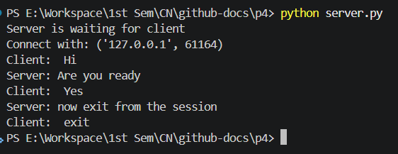
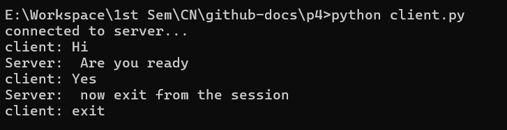

## Computer Network Lab

**Name: Ayush Ravindra Patil**

**Roll No.: 22**

**Section: C (Batch 2)**

**Date: 24-09-26**

**Practical: 4**

### Aim: Implementation of two-way Client/Server communication using TCP Socket.

---

### **1\] Server Code:**

```pythonimport socket
server=socket.socket(socket.AF_INET ,socket.SOCK_STREAM)
server.bind(("127.0.0.1", 8080))
server.listen(1)
print("Server is waiting for client")
conn,addr =server.accept()
print("Connect with:", addr)

while True:
    client_msg = conn.recv(1024).decode()
    print("Client: ", client_msg)

    if client_msg.lower()=="exit":
        break

    reply= input("Server: ")
    conn.send(reply.encode())
    if reply.lower()=="exit":
        break

conn.close()
server.close()
```


**Output:**




---


### **2\] Client Code:**

```python
import socket
client = socket.socket(socket.AF_INET, socket.SOCK_STREAM)
client.connect(("127.0.0.1", 8080))
print("connected to server...")

while True:
    msg = input("client: ")
    client.send(msg.encode())
    if msg.lower() == "exit":
        break
    reply = client.recv(1024).decode()
    print("Server: ",reply)

    if reply.lower() == "exit":
        break
    
client.close()
```


**Output:**


