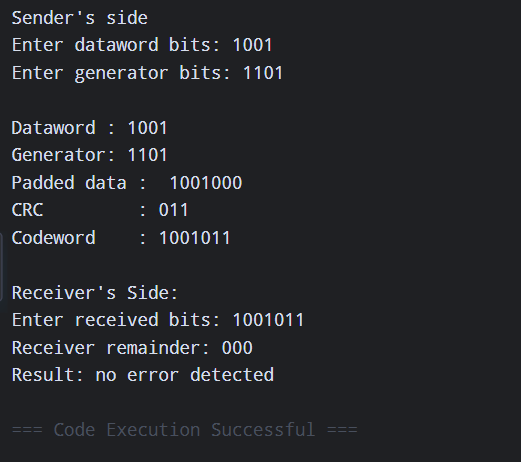
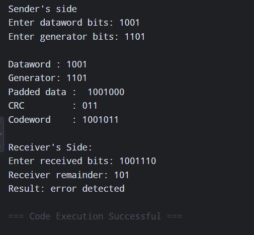

## Computer Network Lab

**Name: Ayush Ravindra Patil**

**Roll No.: 22**

**Section: C (Batch 2)**

**Date: 10-09-26**

**Practical: 5**

### Aim: Implementation of Cyclic Redundancy Check (CRC) for error detection.

---

## **1] Bit Stuffing**

 <div align="right">
   <a href="https://run-python.pages.dev/bit-stuffing.html" target="_blank">
     
   </a>
 </div>
 
**Code:**

```python
def xor_division(bits, generator):
    data = list(bits)
    gen = list(generator)
    for i in range(len(data) - len(gen) + 1):
        if data[i] == '1':
            for j in range(len(gen)):
                data[i + j] = str(int(data[i + j]) ^ int(gen[j]))
    return ''.join(data[-(len(gen) - 1):])

# _-_-_ Sender _-_-_
print("Sender's Side: ")
dataword = input("Enter dataword bits: ")    
generator = input("Enter generator bits: ")
print("\nDataword :", dataword)
print("Generator:", generator)

zeros = '0' * (len(generator) - 1)
padded_data = dataword + zeros
print("Padded data : ", padded_data)

crc = xor_division(padded_data, generator)
print("CRC         :", crc)

codeword = dataword + crc
print('Codeword    :', codeword)

# _-_-_ Receiver _-_-_
print("\nReceiver's Side:")
received = input("Enter received bits: ")
receiver_remainder = xor_division(received, generator)
print("Receiver remainder:", receiver_remainder)

if receiver_remainder == '0' * (len(generator) - 1):
    print("Result: No Error Detected")
else:
    print("Result: Error Detected")
```

**Output:**




---


## **2] Character Stuffing**

 <div align="right">
   <a href="https://run-python.pages.dev/crc.html" target="_blank">
     
   </a>
 </div>

**Code:**

```python
def character_stuffing(data):

    flag = 'F'

    esc = 'E'

    stuffed_data = ''

    for char in data:

        if char == flag or char == esc:

            stuffed_data += esc

        stuffed_data += char

    return flag + stuffed_data + flag

data=input("Enter character frame: ")

print(f'Original Data: {data}')

print(f'Stuffed Data: {character_stuffing(data)}')
```

**Output:**




<details>
  <summary><b>✨ Click here to run this code interactively</b></summary>
  <br>
  You don't need to install Python on your computer to test this assignment! 
  
  I have built a custom Cloudflare web app that lets you edit the code, enter your own inputs, and see the output live in your browser.
  
  👉 <a href="https://run-python.pages.dev/"><b>Open the Live Web Compiler</b></a>
</details>
