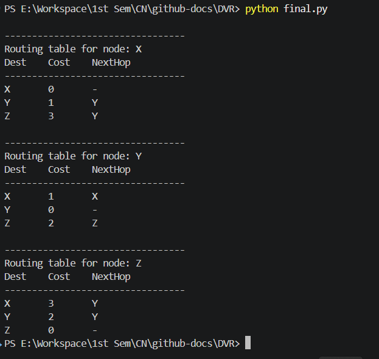

## Computer Network Lab

**Name: Ayush Ravindra Patil**

**Roll No.: 22**

**Section: C (Batch 2)**

**Date: 22-10-26**

**Practical: 8**

### Aim: Implement and verify routing table updates using Distance Vector and Link State Routing algorithms.

---

 <div align="right">
   <a href="https://run-python.pages.dev/dvr.html" target="_blank">
     
   </a>
 </div>

## **1] Distance Vector (Code):**

```python
# - Nodes
nodes = ['X', 'Y', 'Z']

# - initial links
links = [
    ('X', 'Y', 1), ('X', 'Z', 5), ('Y', 'Z', 2)
]

def bellman_ford(nodes, edges, source):
    INF = float('inf')
    dist = {node: INF for node in nodes}
    parent = {node: None for node in nodes}
    dist[source] = 0

    for _ in range(len(nodes) - 1):
        updated = False
        for u, v, w in edges:
            if dist[u] != INF and dist[u] + w < dist[v]:
                dist[v] = dist[u] + w
                parent[v] = u
                updated = True
        
        if not updated:
            break

    for u, v, w in edges:
        if dist[u] != INF and dist[u] + w < dist[v]:
            return None, None
    return dist, parent

def print_routing_tables(nodes, edges):
    for source in nodes:
        dist, parent = bellman_ford(nodes, edges, source)

        if dist is None:
            print(f"Negative cycle reachable from {source}")
            continue

        print(f"\n---------------------------------")
        print(f"Routing table for node: {source}")
        print("Dest\tCost\tNextHop")
        print("---------------------------------")

        for dest in nodes:
            if dist[dest] == float('inf'):
                print(f"{dest}\tINF\t-")
            elif dest == source:
                print(f"{dest}\t0\t-")
            else:
                current = dest
                
                while parent[current] is not None and parent[current] != source:
                    current = parent[current]

                if parent[current] is None:
                    next_hop = "-"
                else:
                    next_hop = current
                print(f"{dest}\t{dist[dest]}\t{next_hop}")

edges = []
for u, v, w in links:
    edges.append((u, v, w))
    edges.append((v, u, w))

print_routing_tables(nodes, edges)
```

### **Output:**



---

 <div align="right">
   <a href="https://run-python.pages.dev/lsr.html" target="_blank">
     
   </a>
 </div>

## **2] Link State Routing (Code):**

```python

```

### **Output:**


<details>
  <summary><b>✨ Click here to run this code interactively</b></summary>
  <br>
  You don't need to install Python on your computer to test this assignment! 
  
  I have built a custom Cloudflare web app that lets you edit the code, enter your own inputs, and see the output live in your browser.
  
  👉 <a href="https://run-python.pages.dev/"><b>Open the Live Web Compiler</b></a>
</details>
